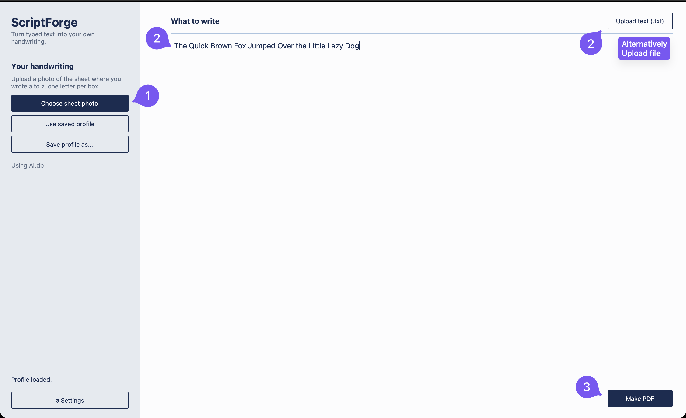
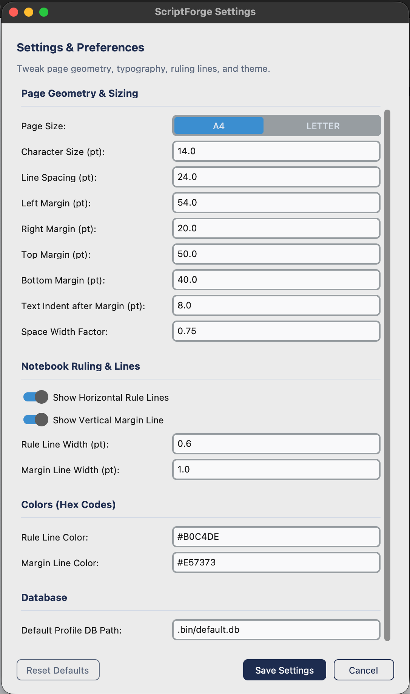

<p align="center">
  
</p>

<h1 align="center">ScriptForge</h1>

<p align="center">
  Synthesize realistic handwritten PDF documents from typed text using your own handwriting samples.
</p>

---

## Overview

ScriptForge extracts character glyphs from reference handwriting sheets and arranges them into ruled notebook PDF pages. It includes an interactive desktop application as well as a scriptable command-line interface.

## Screenshots

<p align="center">
  
</p>

<p align="center">
  
</p>

## Features

- Custom Handwriting Extraction: Scans a 6x6 grid image of handwritten characters (a-z, 0-9) and stores them in SQLite database profiles (.db).
- Desktop GUI: Clean notebook-style interface with a built-in text editor, keyboard word deletion shortcuts, and text file upload support.
- Live Settings: Adjust page geometries, character sizing, line spacing, margins, and ruling colors directly in the GUI.
- PDF Synthesis: Generates clean, multi-page ruled PDFs with configurable layouts (A4, Letter).
- Dual Mode: Launch the graphical desktop interface or execute headless synthesis from the command line.

## Installation

Ensure Python 3.14 or later is installed along with uv:

```bash
git clone https://github.com/Chetan-boi/scriptforge.git
cd scriptforge
uv sync
```

## Usage

### Desktop Application

Launch the desktop interface (default mode):

```bash
uv run scriptforge
```

Or launch GUI mode explicitly:

```bash
uv run scriptforge-gui
```

### Command Line Interface

Launch the interactive CLI menu:

```bash
uv run scriptforge-cli
```

Or synthesize directly in a single command:

```bash
uv run scriptforge-cli <sample_image_or_profile> <text_input_or_file> [output_path]
```

Examples:

```bash
# Extract sheet and generate PDF
uv run scriptforge-cli sample.png "Synthesize this text" output.pdf

# Use an existing handwriting profile and text file
uv run scriptforge-cli my_handwriting.db notes.txt output.pdf
```

## Configuration

Settings can be adjusted through the GUI Settings window or edited directly in `config.toml`:

```toml
[page]
size = "A4"
char_size = 14.0
line_spacing = 24.0
left_margin = 54.0
right_margin = 20.0
top_margin = 50.0
bottom_margin = 40.0
margin_indent = 8.0
space_width_factor = 0.75
show_rules = true
show_margin = true
rule_line_width = 0.6
margin_line_width = 1.0

[colors]
rule_line = "#B0C4DE"
margin_line = "#E57373"
desk = "#E6EAF0"
paper = "#FCFCFD"
ink = "#1D2B4F"

[database]
default_path = ".bin/default.db"
```

## Standalone macOS Application

To package the application into a standalone macOS bundle:

```bash
uv run pyinstaller \
    --name "ScriptForge" \
    --windowed \
    --noconfirm \
    --icon "Scriptforge1.icns" \
    --paths src \
    --collect-all customtkinter \
    --collect-all reportlab \
    --add-data "config.toml:." \
    app.py
```

The resulting `ScriptForge.app` bundle will be generated inside the `dist/` directory.
